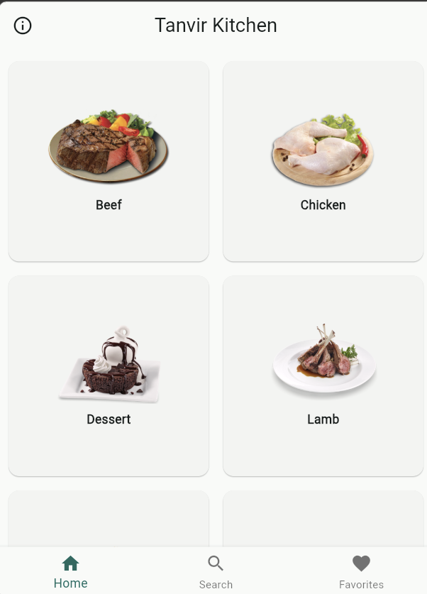
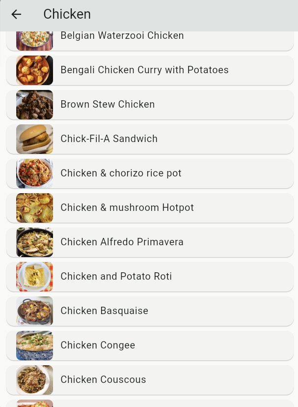
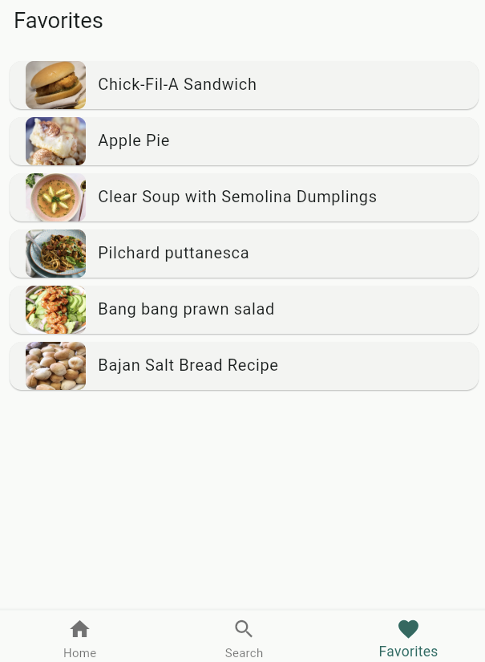
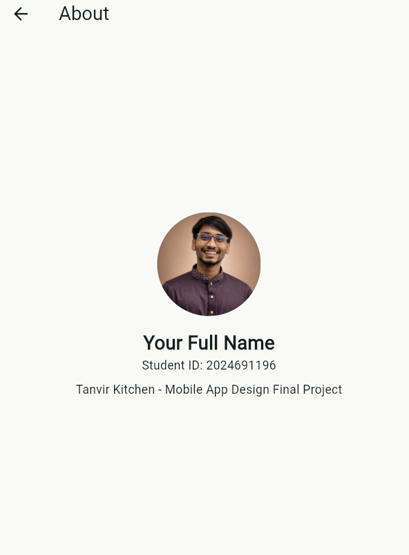

# Tanvir Kitchen (Recipe Explorer)

**Name:** Bhuiyan Tanvir Hasan
**Student ID:** 2024691196
**App name:** Tanvir Kitchen

Final project for Mobile App Design (Flutter), Semester 2026-2.
A recipe app that uses the TheMealDB API: browse categories, search meals,
read full recipes, and save favorites on the device.

## Flutter version
Flutter 3.47.4 • channel stable • https://github.com/flutter/flutter.git

## Features
- Home screen with a grid of meal categories
- Meal list for each category
- Meal detail with image, category, area, ingredients and instructions
- Search by meal name, with a "no meals found" message
- Favorites saved on the device with shared_preferences (they stay after restarting the app)
- Bottom navigation bar: Home, Search, Favorites
- Loading indicator and error message with a Retry button
- About screen with my name, student ID and photo

## How to run
1. Install Flutter and set up an Android emulator.
2. Clone this repository.
3. Open a terminal in the project folder and run:
   ```
   flutter pub get
   flutter run
   ```
4. The emulator needs an internet connection.

## Screenshots
Home screen


Meal details


Favorites


About Me



## Optional extensions
None.